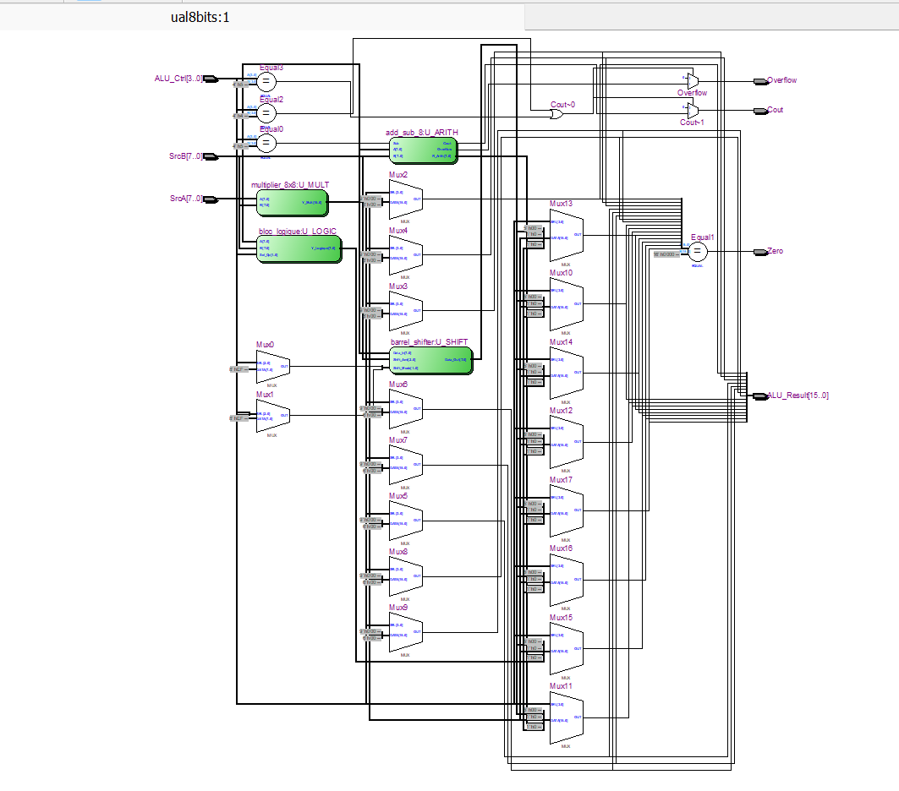
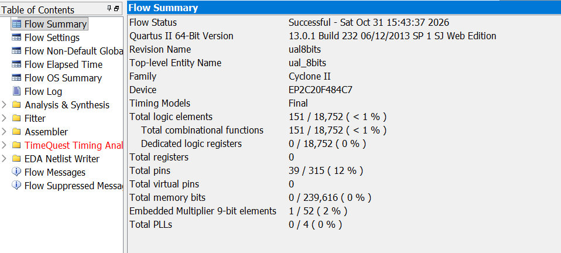
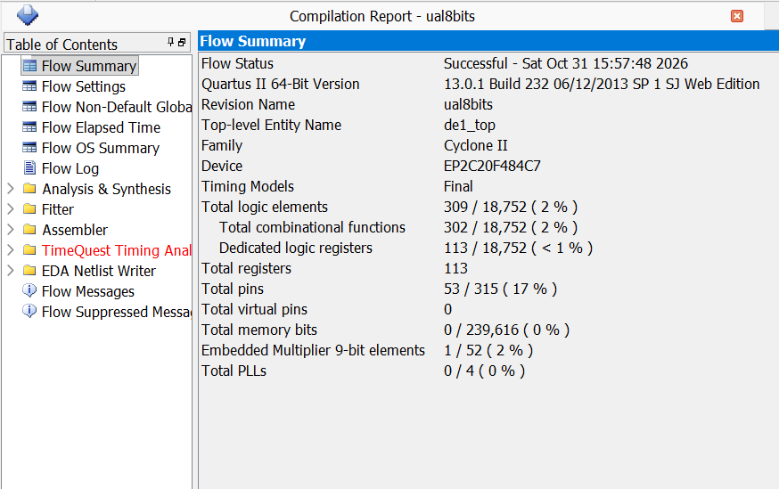
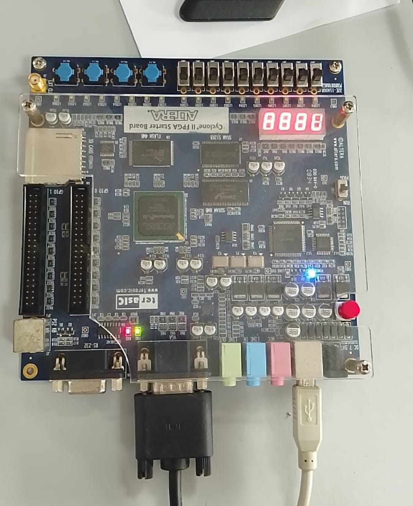

\# 8-Bit ALU Design and FPGA Implementation


\## Project Overview


This project focuses on the design, simulation, and FPGA implementation of an 8-bit Arithmetic Logic Unit (ALU) using VHDL.


The ALU integrates several arithmetic and logical operations through a modular hardware architecture. The design is verified using ModelSim and synthesized using Intel/Altera Quartus II, targeting the Cyclone II FPGA.


\## Architecture


The ALU consists of the following functional modules:


| Module | Description |

|---|---|

| Logic Unit | Bitwise logical operations |

| Adder/Subtractor | 8-bit arithmetic operations |

| Barrel Shifter | Logical and arithmetic shift operations |

| Multiplier | 8 × 8-bit multiplication |

| ALU Top Level | Integration and operation selection |

| DE1 Top Level | FPGA switches, push-buttons and seven-segment displays |

### RTL Architecture

The following RTL schematic illustrates the hardware
architecture of the 8-bit ALU synthesized using Quartus II.



\## Tools and Technologies


\- \*\*Hardware Description Language:\*\* VHDL

\- \*\*Simulation:\*\* ModelSim

\- \*\*Synthesis and Implementation:\*\* Quartus II

\- \*\*FPGA:\*\* Altera Cyclone II

\- \*\*Development Board:\*\* DE1


\## Functional Verification


Dedicated VHDL testbenches are provided to verify individual modules and the integrated ALU.


The verification scenarios include:


\- Addition with carry.

\- Subtraction and signed overflow cases.

\- Multiplication, including 255 × 2.

\- Logical and arithmetic shifts.

\- Arithmetic right shift of negative signed values.

\- Logic operations and ALU control selection.

### ModelSim Simulation Results

The following waveform illustrates the functional verification
of the 8-bit ALU using a VHDL testbench.


\## FPGA Implementation


The design includes a DE1 top-level module for hardware interaction through switches, push-buttons, and seven-segment displays.


The Quartus II project files are included to support synthesis and FPGA implementation.
## FPGA Synthesis Results

The 8-bit ALU was successfully synthesized using
Quartus II 13.0 SP1, targeting the Altera Cyclone II
EP2C20F484C7 FPGA.

### Resource Utilization

| FPGA Resource | Utilization |
|---|---|
| Logic Elements | 151 / 18,752 (<1%) |
| Combinational Functions | 151 |
| Registers | 0 |
| I/O Pins | 39 / 315 (12%) |
| Embedded 9-bit Multipliers | 1 / 52 (2%) |
| Memory Bits | 0 |
| PLLs | 0 |

The synthesis results confirm that the ALU is a
combinational architecture requiring no registers.

The multiplication operation is mapped to one
embedded hardware multiplier.

### Quartus II Flow Summary



### DE1 FPGA Integration — Synthesis Results

The complete system integrates the 8-bit ALU with
the DE1 board interface, including operand storage,
operation selection, push-buttons, switches, and
seven-segment displays.

| FPGA Resource | ALU Core | DE1 Integration |
|---|---:|---:|
| Logic Elements | 151 | 309 |
| Combinational Functions | 151 | 302 |
| Registers | 0 | 113 |
| I/O Pins | 39 | 53 |
| Embedded Multipliers | 1 | 1 |
| Memory Bits | 0 | 0 |

The integration increases logic utilization from
151 to 309 Logic Elements while introducing
113 registers for sequential functionality.

Both implementations use one embedded multiplier.



### Resource Utilization Analysis

The increase from **151 to 309 Logic Elements (LEs)**
is mainly associated with the integration of the ALU
into the DE1 FPGA interface, including operand storage,
control logic, and seven-segment display decoding.

Unlike the standalone ALU, which is purely combinational
and requires no registers, the DE1 implementation introduces
**113 registers** for sequential functionality, including
operand memorization and control mechanisms.

Both implementations use **one embedded hardware multiplier**.
The additional resource utilization is therefore primarily
associated with interface and control circuitry rather than
increased arithmetic complexity.
## Hardware Validation — Cyclone II FPGA

The 8-bit ALU was implemented on an Altera Cyclone II FPGA using Quartus II and programmed through the JTAG interface.
### FPGA Hardware Demonstration

The following image shows the 8-bit ALU implemented
and tested on the Cyclone II FPGA development board.


### Hardware Test Setup

- **FPGA:** Cyclone II EP2C20F484C7
- **Development Board:** DE1
- **Programming Tool:** Quartus II Programmer
- **Configuration File:** SRAM Object File (.sof)
- **Inputs:** Switches and push-buttons
- **Outputs:** Seven-segment displays

### Hardware Verification

The DE1 top-level architecture provides an interface for testing ALU operations directly on the FPGA.

The hardware implementation supports:

- Operand selection and storage using switches and push-buttons.
- Arithmetic operations: addition and subtraction.
- Bitwise logical operations.
- Logical and arithmetic shifts.
- Multiplication.
- Result visualization through seven-segment displays.

### Validation Summary

The ALU was programmed onto the Cyclone II FPGA and tested through the physical board interface, complementing the functional simulations performed in ModelSim.

This implementation demonstrates the complete digital design workflow, from VHDL description and functional verification to synthesis, FPGA programming, and hardware testing.

\## Repository Structure


```text

8-bit-ALU-FPGA/

├── add\_sub\_8.vhd

├── barrel\_shifter.vhd

├── bloc\_logique.vhd

├── multiplier\_8x8.vhd

├── ual\_8bits.vhd

├── de1\_top.vhd

├── ual8bits.qpf

├── ual8bits.qsf

├── simulation/

│   ├── tb\_add\_sub\_8.vhd

│   ├── tb\_barrel\_shifter.vhd

│   ├── tb\_bloc\_logique.vhd

│   ├── tb\_comparaison\_add\_sub.vhd

│   ├── tb\_multiplier\_8x8.vhd

│   ├── tb\_ual\_8bits.vhd

│   ├── tb\_de1\_top.vhd

│   └── wave.do

└── README.md

```


\## Future Improvements


\- Extend the ALU architecture to 16 bits.

\- Explore processor datapath integration.

\- Expand automated verification scenarios.

\- Compare alternative arithmetic architectures in terms of FPGA resource utilization and timing.


\## Author


\*\*Fatima Zahra Jerrouda\*\*


Electronic & Automatic Systems Engineering Student — ENSA Tangier, Morocco


Interests: Digital Design, FPGA, Embedded Systems, and IC/VLSI Design.

