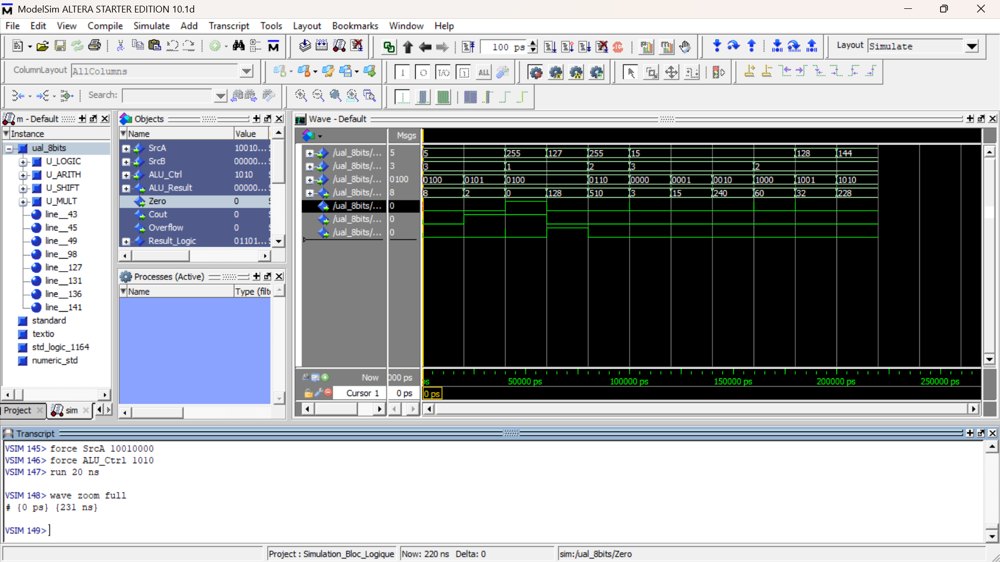

\# 8-Bit ALU Design and FPGA Implementation


\## Project Overview


This project focuses on the design, simulation, and FPGA implementation of an 8-bit Arithmetic Logic Unit (ALU) using VHDL.


The ALU integrates several arithmetic and logical operations through a modular hardware architecture. The design is verified using ModelSim and synthesized using Intel/Altera Quartus II, targeting the Cyclone II FPGA.


\## Architecture


The ALU consists of the following functional modules:


| Module | Description |

|---|---|

| Logic Unit | Bitwise logical operations |

| Adder/Subtractor | 8-bit arithmetic operations |

| Barrel Shifter | Logical and arithmetic shift operations |

| Multiplier | 8 × 8-bit multiplication |

| ALU Top Level | Integration and operation selection |

| DE1 Top Level | FPGA switches, push-buttons and seven-segment displays |


\## Tools and Technologies


\- \*\*Hardware Description Language:\*\* VHDL

\- \*\*Simulation:\*\* ModelSim

\- \*\*Synthesis and Implementation:\*\* Quartus II

\- \*\*FPGA:\*\* Altera Cyclone II

\- \*\*Development Board:\*\* DE1


\## Functional Verification


Dedicated VHDL testbenches are provided to verify individual modules and the integrated ALU.


The verification scenarios include:


\- Addition with carry.

\- Subtraction and signed overflow cases.

\- Multiplication, including 255 × 2.

\- Logical and arithmetic shifts.

\- Arithmetic right shift of negative signed values.

\- Logic operations and ALU control selection.

### ModelSim Simulation Results

The following waveform illustrates the functional verification
of the 8-bit ALU using a VHDL testbench.



\## FPGA Implementation


The design includes a DE1 top-level module for hardware interaction through switches, push-buttons, and seven-segment displays.


The Quartus II project files are included to support synthesis and FPGA implementation.


\## Repository Structure


```text

8-bit-ALU-FPGA/

├── add\_sub\_8.vhd

├── barrel\_shifter.vhd

├── bloc\_logique.vhd

├── multiplier\_8x8.vhd

├── ual\_8bits.vhd

├── de1\_top.vhd

├── ual8bits.qpf

├── ual8bits.qsf

├── simulation/

│   ├── tb\_add\_sub\_8.vhd

│   ├── tb\_barrel\_shifter.vhd

│   ├── tb\_bloc\_logique.vhd

│   ├── tb\_comparaison\_add\_sub.vhd

│   ├── tb\_multiplier\_8x8.vhd

│   ├── tb\_ual\_8bits.vhd

│   ├── tb\_de1\_top.vhd

│   └── wave.do

└── README.md

```


\## Future Improvements


\- Extend the ALU architecture to 16 bits.

\- Explore processor datapath integration.

\- Expand automated verification scenarios.

\- Compare alternative arithmetic architectures in terms of FPGA resource utilization and timing.


\## Author


\*\*Fatima Zahra Jerrouda\*\*


Electronic Systems Engineering Student — ENSA Tangier, Morocco


Interests: Digital Design, FPGA, Embedded Systems, and IC/VLSI Design.

